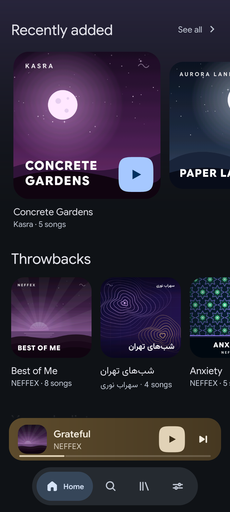
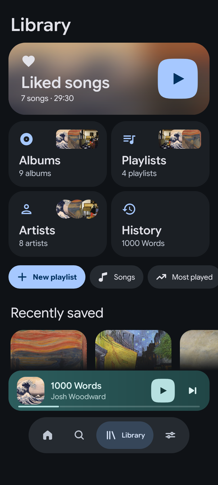
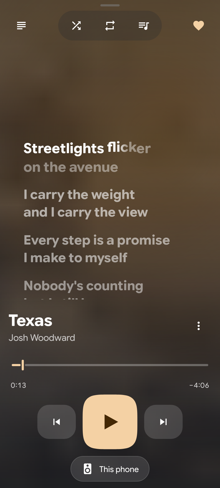
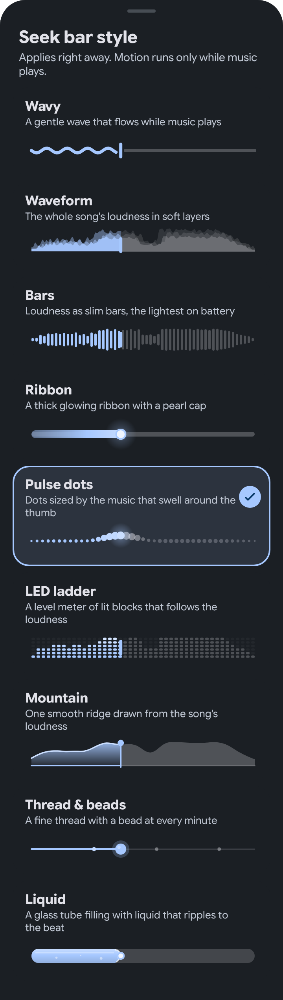
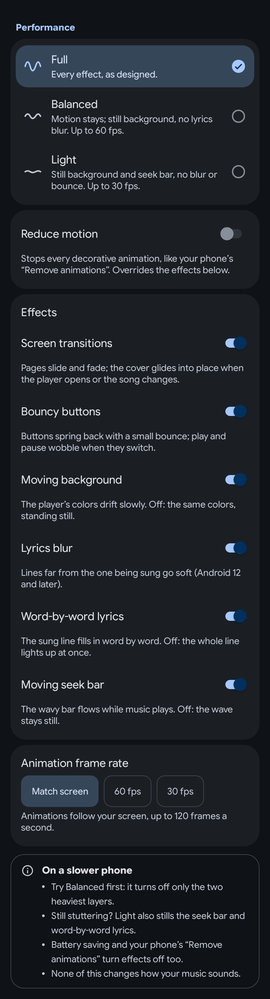
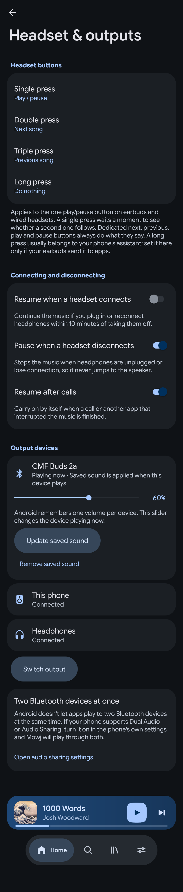
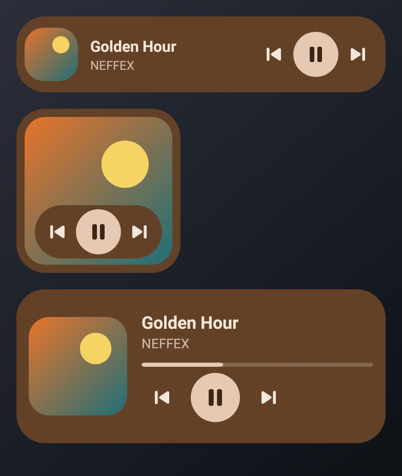
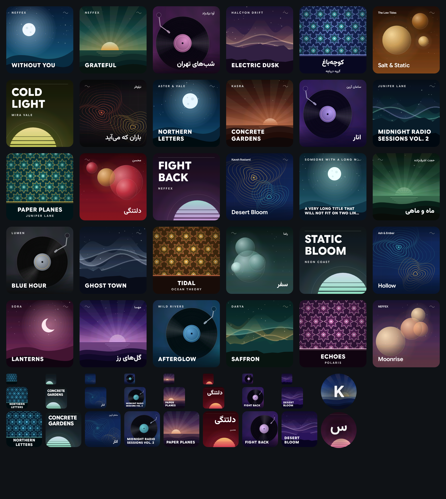

<p align="center">
  
</p>

<h1 align="center">Mowj / موج</h1>

<p align="center"><b>A light, good-looking music player for the songs already on your phone.</b><br>
Word-synced lyrics, nine seek bars, a living backdrop, and a design built around low battery and RAM use.</p>

<p align="center">
  
  
  
  
</p>

> Persian version: [README.fa.md](README.fa.md) - Changes: [CHANGELOG.md](CHANGELOG.md) - Download: [Releases](https://github.com/mhrsdev/music-player-mowj/releases)

Mowj (Persian: *موج*, "wave") plays local files only. No accounts, no ads, no streaming, no analytics.
Package `com.mhrsdev.musicplayer`, minSdk 26 (Android 8.0), target/compile SDK 37. Java only (no Kotlin), XML layouts + custom Views, MVVM, Media3, framework SQLite (no Room).

> **Read this first.** Almost everything was verified with JVM tests and Robolectric renders, plus a few things on the
> maintainer's own phone (install, notification card). Headset buttons, the lyrics file picker, Android Auto,
> widgets on other launchers, and battery and RAM numbers are **not yet verified on real devices**. See [Known limitations](#known-limitations).

## Screenshots

Renders produced by the app's own code on sample data (Robolectric, real cover art, CC-licensed track metadata; see [`docs/CREDITS.md`](docs/CREDITS.md)). They are not photos of a device, so fonts and blur can differ slightly on a phone.

<table>
  <tr>
    <td align="center" valign="top"><br>Home</td>
    <td align="center" valign="top"><br>Library</td>
    <td align="center" valign="top"><br>Word-synced lyrics</td>
    <td align="center" valign="top"><br>Seek bar styles</td>
  </tr>
  <tr>
    <td align="center" valign="top"><br>Performance</td>
    <td align="center" valign="top"><br>Headset &amp; outputs</td>
    <td align="center" valign="top"><br>Widgets</td>
    <td align="center" valign="top"><br>Generated covers</td>
  </tr>
</table>

More renders (light theme, Persian / RTL, sleep timer, queue, backup, update screens) are in [`docs/screens/`](docs/screens/).

## Features

**Library and playback**
- Incremental MediaStore scan into SQLite; songs, albums, artists, playlists, liked songs, history, play counts, sort options, multi-select, track details / share / delete. A rescan button and a music-folder picker are in Settings.
- Home feed built from your own library and listening (quick picks, recently added, throwbacks, mixes, decades, genres), and search across songs / albums / artists / playlists.
- Playlists (create, rename, delete, add / remove tracks), queue (play next, add, drag to reorder, swipe to remove with undo, shuffle with undo, repeat off / all / one), queue and position restored after a restart, sleep timer (minutes with fade-out, or end of track).
- Media3 ExoPlayer in a foreground `MediaSessionService`: notification and lock-screen controls, audio focus, pause when headphones unplug.
- **Sound**: equalizer, bass boost, virtualizer, loudness, playback speed, skip silence, ReplayGain (only lowers volume, never boosts).

**Look and feel**
- **9 seek-bar styles** with a live-preview picker: Wavy, Waveform, Bars, Ribbon, Pulse dots, LED ladder, Mountain, Thread and beads, Liquid. The loudness-based styles use the real loudness of the song, extracted on the phone and cached.
- **Word-synced lyrics** with per-word fill, a soft blur that grows with distance from the sung line, tap-to-seek, a per-track timing offset and text size. Lines without word timing get an estimated word sweep. Details: [`docs/LYRICS_AND_BACKDROP.md`](docs/LYRICS_AND_BACKDROP.md).
- **Living backdrop**: colors from the cover drift slowly behind the player and lyrics, and tint Home and the album / artist / playlist headers.
- **Generated covers** for songs without artwork: deterministic night-scene art, the same on every launch, Persian-capable, used in the app, notification and widgets. See [`docs/GENERATED_COVERS.md`](docs/GENERATED_COVERS.md).
- **Themes**: system / light / dark / black, optional colors from the cover, and **Material You dynamic color** (Android 12+, off by default so the Mowj identity stays). Spring-based motion and a shape-morphing play / pause button. See [`docs/THEMING.md`](docs/THEMING.md).
- **Edge-to-edge** layouts that handle cutouts and gesture / 3-button navigation, plus an optional immersive player.
- **English and Persian (RTL)**, Vazirmatn for Persian text, Google Sans Flex for Latin. The language can be switched in Settings.

**Lyrics sources** (first hit wins; results and misses are cached):
1. Sidecar file next to the audio with the same name: `.lrc`, `.elrc`, `.json` (also `.ttml` and `.txt`).
2. Embedded tags: ID3 `USLT` / `SYLT`, FLAC / Vorbis `LYRICS`, MP4 `©lyr`.
3. [LRCLIB](https://lrclib.net) (free, no key; can be switched off).

Tags that only hold a site watermark or advert are ignored. When nothing is found you can **search manually** or **add a lyrics file** from the empty state, and the lyrics button is hidden for tracks without lyrics.

**Performance (Settings > Performance)**
- Presets **Full** (default), **Balanced** (no lyrics blur, still background, up to 60 fps) and **Light** (also a still seek bar, no bounce, up to 30 fps).
- Individual switches: screen transitions, bouncy buttons, moving background, lyrics blur, word-by-word lyrics, moving seek bar, and an animation frame-rate cap (match screen / 60 / 30). Changes apply live. Reduce motion and Android battery saver turn decorative effects off too.

**Headset and outputs (Settings > Headset)**
- Map **single / double / triple / long press** of the one play-pause button on earbuds and wired headsets (default: play-pause, next, previous, nothing).
- Resume when a headset connects, pause when it disconnects, resume after phone calls.
- **Output devices**: lists connected outputs, marks the active one, shows its volume, opens the system output switcher, and keeps a **saved sound profile per device** (EQ, bass, speed) that is applied when that device plays.
- Manual test list: [`docs/HEADSET_CHECKLIST.md`](docs/HEADSET_CHECKLIST.md).

**System**
- Three **home-screen widgets** (compact, square, wide).
- **Android Auto** browse tree (recently added, most played, liked, playlists, albums, artists) and playback resumption.
- **Backup / restore** of playlists, likes and history to a file you choose (tracks are matched back by their tags).
- **Auto-update from GitHub Releases**: checks at most once a day while the app is open, plus a manual button; never in the background. The APK is verified by **SHA-256** and by its **signing certificate** before the system installer opens, and you confirm the install.

**Built for low battery and RAM**
- No WorkManager, alarms, boot receivers, extra wake locks or background polling. The service stops about 60 s after playback stops.
- Animations run through one shared frame driver, only while visible and playing. No live blur: blur is computed once into a tiny bitmap.
- Network is used only for the optional lyrics lookup (when the lyrics view is open) and the update check.
- Budgets enforced by a source-scan test: [`docs/PERF_BUDGET.md`](docs/PERF_BUDGET.md). Claims with code evidence and how to measure them on a device: [`docs/BATTERY_AUDIT.md`](docs/BATTERY_AUDIT.md). The release APK is about 3 MB.

## Install

1. Download `MusicPlayer-vX.Y.Z.apk` (and optionally the `.sha256`) from the [Releases page](https://github.com/mhrsdev/music-player-mowj/releases).
2. Optional check: `sha256sum -c MusicPlayer-vX.Y.Z.apk.sha256`.
3. Open the APK on the phone. When Android asks, allow **Install unknown apps** for your browser or file manager.
4. Open Mowj and allow access to music (and notifications on Android 13+).

Releases from `v0.2.0` on are signed with the maintainer's release key, so a later version installs over an earlier one and keeps your data. `v0.1.0` was signed with a debug key; going from it to a later version needs one uninstall (this loses likes and playlists). After that, Mowj can update itself from Settings.

## Build from source

Requirements: JDK 17+ (built with 21), Android SDK with `platforms;android-37.0` and a recent `build-tools`.

```bash
export ANDROID_HOME=/opt/android-sdk        # or sdk.dir in local.properties (gitignored)
./gradlew :app:assembleDebug test lint      # what CI runs on every push
adb install -r app/build/outputs/apk/debug/app-debug.apk
```

Toolchain: Gradle wrapper **9.0.0**, Android Gradle Plugin **8.13.2** (newest that runs on Gradle 9.0.0), Java 17 source level, compileSdk / targetSdk 37, minSdk 26. Dependency versions are in `gradle/libs.versions.toml`.

<details><summary>Installing the Android SDK on a bare Linux box</summary>

```bash
mkdir -p /opt/android-sdk/cmdline-tools && cd /tmp
curl -fLO https://dl.google.com/android/repository/commandlinetools-linux-11076708_latest.zip
unzip -q commandlinetools-linux-11076708_latest.zip
mv cmdline-tools /opt/android-sdk/cmdline-tools/latest
yes | /opt/android-sdk/cmdline-tools/latest/bin/sdkmanager --sdk_root=/opt/android-sdk --licenses
/opt/android-sdk/cmdline-tools/latest/bin/sdkmanager --sdk_root=/opt/android-sdk \
  "platform-tools" "platforms;android-37.0" "build-tools;35.0.0"
```
</details>

### Releasing and signing

Releases are built by `.github/workflows/release.yml`: push a tag `vX.Y.Z`, or run the workflow by hand (GitHub > Actions > *Release* > *Run workflow*, branch `main`, version `X.Y.Z`). It runs the unit tests and `assembleRelease`, then publishes a GitHub Release titled "Mowj vX.Y.Z" with the APK, its `.sha256` and the matching `CHANGELOG.md` section. A version without a `-` suffix is a normal (stable, "latest") release; `v1.0.0-rc.1` would be a pre-release. `v0.1.0` and `v0.2.0` were pre-releases; `v0.3.0` onward are normal releases.

The release keystore is **not in the repository**. It lives only in GitHub Actions secrets (`ANDROID_KEYSTORE_BASE64`, `ANDROID_KEYSTORE_PASSWORD`, `ANDROID_KEY_ALIAS`, `ANDROID_KEY_PASSWORD`). Without them, a local or fork build falls back to the Android debug key, which is fine for testing but cannot update over a release build. The in-app updater refuses an APK whose signing certificate differs from the installed one.

The version comes from `-PappVersionName` / `-PappVersionCode` (the workflow sets them).

## Architecture

Single `:app` module, package-by-layer. Contracts between UI and the rest: [`docs/ARCHITECTURE.md`](docs/ARCHITECTURE.md).

```
 ui/*  (Activity, Fragments, custom Views)        View       - ViewBinding, no business logic
   |  observes LiveData / calls intents
 ui/*ViewModel                                    ViewModel  - LiveData only, no Context / View refs
   |
 domain/repository (interfaces) + domain/model (records)
   ^                       ^
 data/*                 playback/*
 SQLite, scanner,       Media3 ExoPlayer + MediaSessionService,
 lyrics, waveform,      queue store, sleep timer, audio effects,
 settings, backup,      headset controls
 update
 di/AppContainer  - hand-written DI (no Hilt/Koin), cheap to construct
```

- `ui` never imports `data.*` / `playback.*`; it only sees `domain` interfaces handed out by `di/AppContainer`.
- All SQL lives in `data/db/query/*Queries`; table and column names in `data/db/contract/*Contract`. No Room, no Kotlin, no coroutines / RxJava.
- Artwork is loaded by a small own bitmap loader with a capped `LruCache` (no image library).

## Tests

```bash
./gradlew test      # JVM unit tests (JUnit 4 + Robolectric): data, lyrics, playback logic, ViewModels, widgets, perf budget, renders
./gradlew lint
```

CI (`.github/workflows/android.yml`) runs `assembleDebug test lint` on every push. There are no instrumented (on-device) tests yet.

## Permissions

| Permission | Why |
|---|---|
| `READ_MEDIA_AUDIO` (Android 13+) / `READ_EXTERNAL_STORAGE` (up to Android 12L) | read your music from MediaStore |
| `POST_NOTIFICATIONS` | playback notification (Android 13+) |
| `FOREGROUND_SERVICE`, `FOREGROUND_SERVICE_MEDIA_PLAYBACK` | keep music playing in the background |
| `WAKE_LOCK` | CPU awake only while a local file plays (ExoPlayer) |
| `BLUETOOTH_CONNECT` (Android 12+) | show the name of the connected Bluetooth output |
| `INTERNET`, `ACCESS_NETWORK_STATE` | optional LRCLIB lyrics lookup and the GitHub update check |
| `REQUEST_INSTALL_PACKAGES` | hand a downloaded update to the system installer (you confirm it) |

## Privacy

No analytics, ads, accounts, crash reporting or tracking. Library, likes, playlists and history stay on the device (`allowBackup` is off; use the in-app backup if you want a copy). Two kinds of network request, both on demand:
- Lyrics lookup: sends the track **title, artist, album and duration** to `lrclib.net` when nothing is found locally and online lyrics are on (Settings > Lyrics).
- Update check: asks the GitHub Releases API for the latest version, at most once a day while the app is open.

## Known limitations

- **Not verified on real devices**: headset / earbud buttons (the app logic is tested, the phone's key delivery is not), the lyrics file picker, Android Auto, widgets on other launchers, the themed launcher icon, dynamic color on real wallpapers, battery drain and RAM numbers, blur cost on low-end GPUs. Visuals come from Robolectric renders.
- **Two Bluetooth devices at the same time**: Android has no public API for this. If your phone offers Dual Audio / Audio Sharing, Mowj links to it; otherwise it plays to one output.
- **Aggressive battery managers** (Xiaomi, Oppo, Realme, Samsung "sleeping apps") can freeze or kill the app and stop headset buttons from waking it. Turn off battery optimisation for Mowj on those phones.
- The system-drawn media card on some phones (One UI, Android 13+) draws its own seek bar from the media session; apps cannot restyle it.
- Persian text has not been reviewed by a native speaker.
- LRCLIB availability is outside our control, and word timing exists only if the file or LRCLIB entry has it (otherwise it is estimated).
- No streaming or online catalog: local files only. No tag editor or crossfade yet.

## Contributing / project rules

Java only (`git ls-files | grep -E '\.kts?$'` must print nothing; Gradle files are Groovy), MVVM, no Room, no `final` classes, Java 17, Gradle 9.0.0. Battery and RAM use are hard requirements (`docs/PERF_BUDGET.md`). Read `CLAUDE.md`, `docs/STATUS.md` and `docs/ARCHITECTURE.md` first. Work on a branch; `main` is the delivered state.

## License

Released under the [MIT License](LICENSE) - Copyright (c) 2026 mhrsdev.

Bundled fonts (Google Sans Flex, Vazirmatn) are under the SIL Open Font License 1.1; see
[`app/src/main/assets/licenses/FONTS-NOTICE.txt`](app/src/main/assets/licenses/FONTS-NOTICE.txt). Sample cover art and track metadata used in screenshots: [`docs/CREDITS.md`](docs/CREDITS.md).
