# Music Player (Android)

 

A fast, battery-friendly **local-library music player** for Android with its own visual identity, synced lyrics,
three seek-bar styles and first-class Persian / RTL support.

> **Status: pre-release `v0.1.0`.** It builds and passes its unit tests, but so far it has only been exercised through JVM tests and Robolectric renders:
> it has **not been verified on a physical device or emulator yet**. See [Known limitations](#known-limitations).
> Persian version: [README.fa.md](README.fa.md) - Changes: [CHANGELOG.md](CHANGELOG.md)

- Package `com.mhrsdev.musicplayer`, minSdk 26 (Android 8.0), target/compile SDK 37
- **Java only** (no Kotlin), XML layouts + custom Views, MVVM, framework SQLite (no Room), Media3

## Screens

Real renders produced by the app code on sample data (Robolectric, from `docs/screens/`; not from a device):

| Home | Home (Persian, RTL) | Home (light) |
|---|---|---|
| 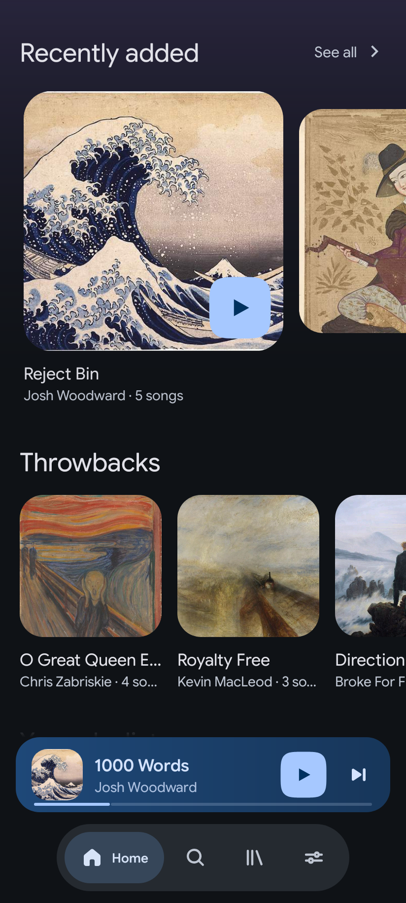 | 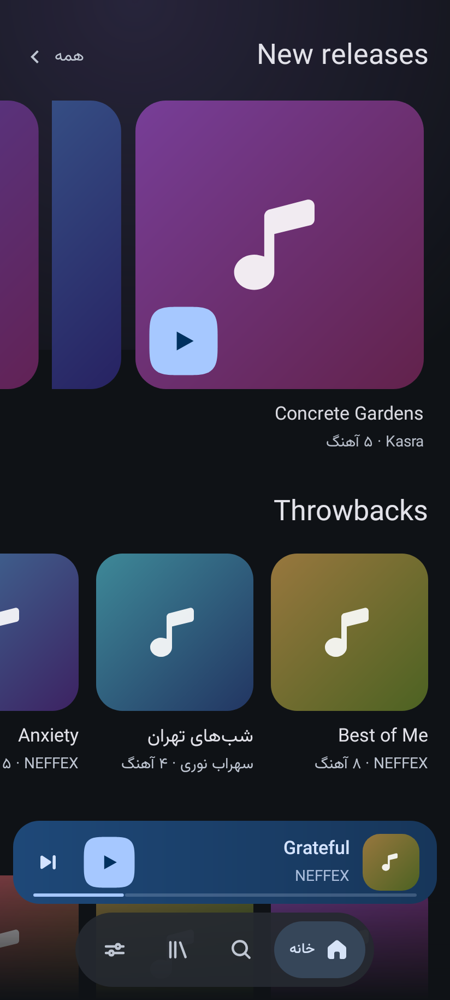 | 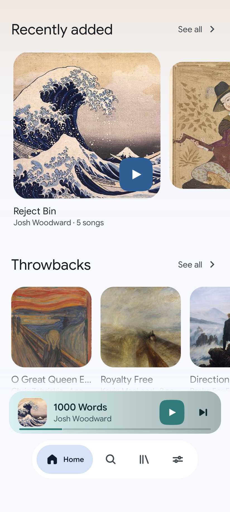 |

| Library | Artists | Search |
|---|---|---|
|  | 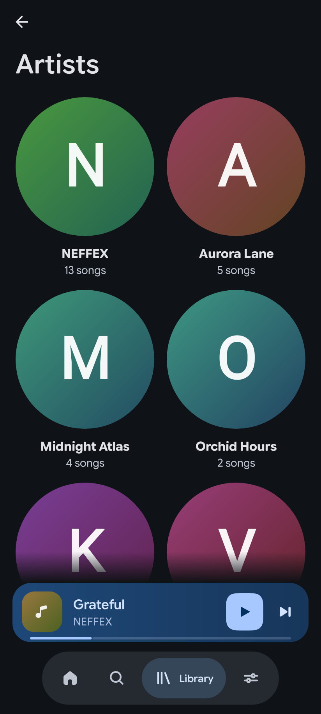 | 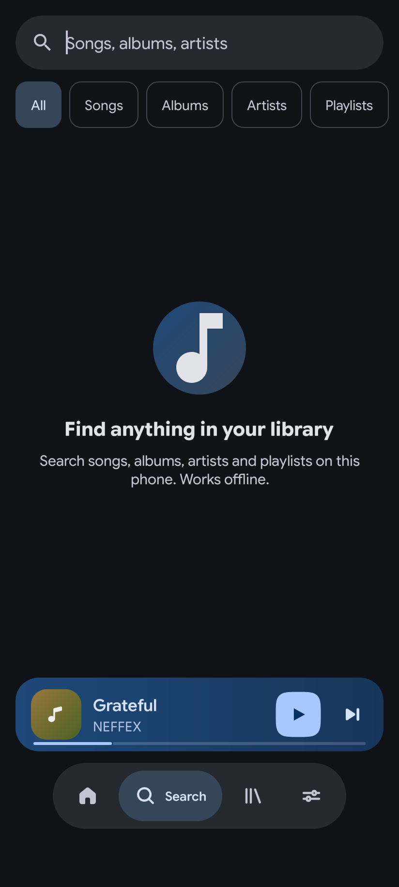 |

Player (dark / light). These two renders have **no track loaded** (empty title, disabled transport buttons); the lyrics view
is not shown for the same reason. For a populated player see the design mockups below.

| Player dark | Player light | Widget gallery |
|---|---|---|
| 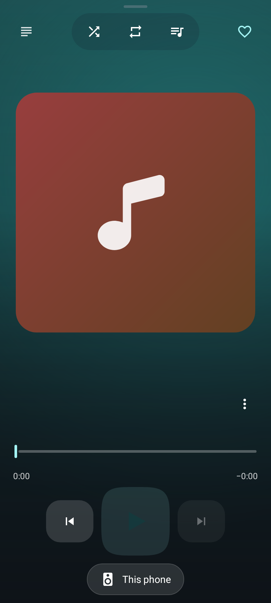 | 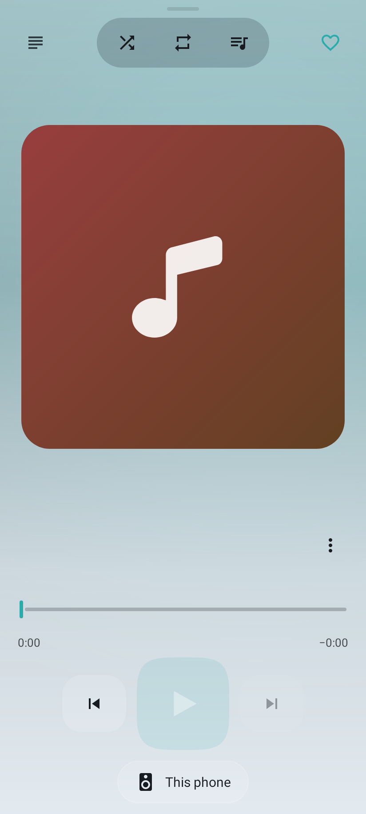 | 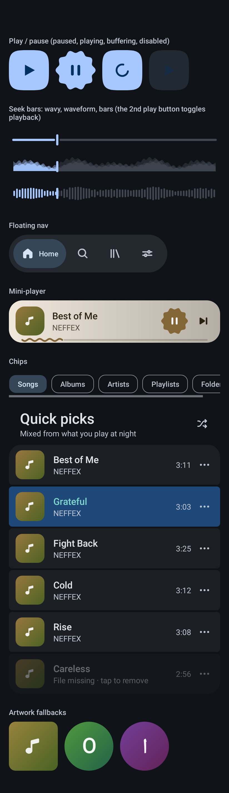 |

Design target (browser mockups, `docs/design/`; the implementation follows them but is not pixel-identical):

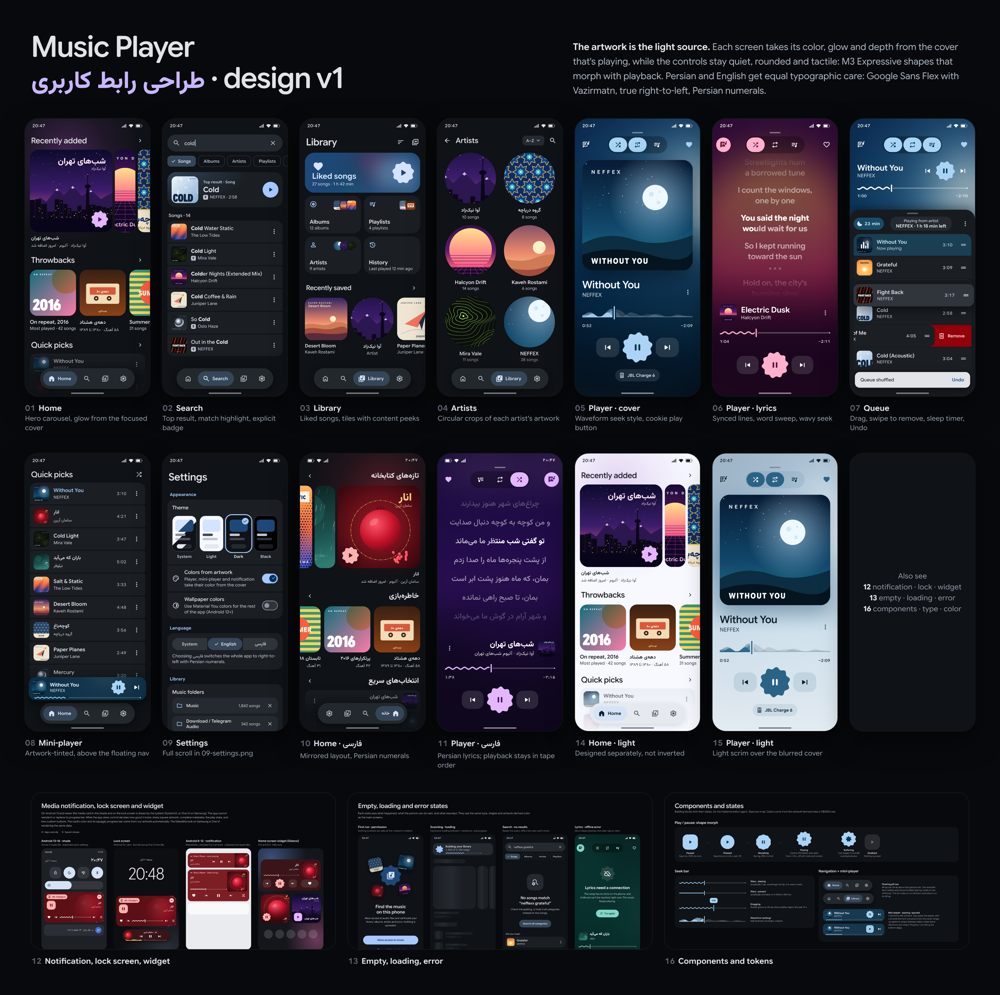

| Player | Lyrics | Queue | RTL player |
|---|---|---|---|
| 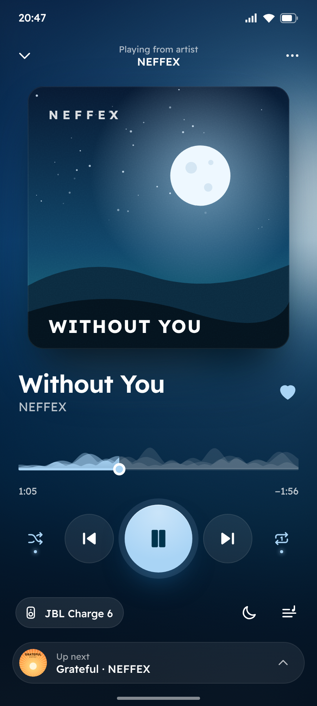 | 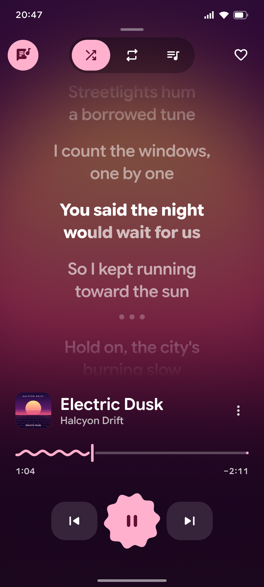 | 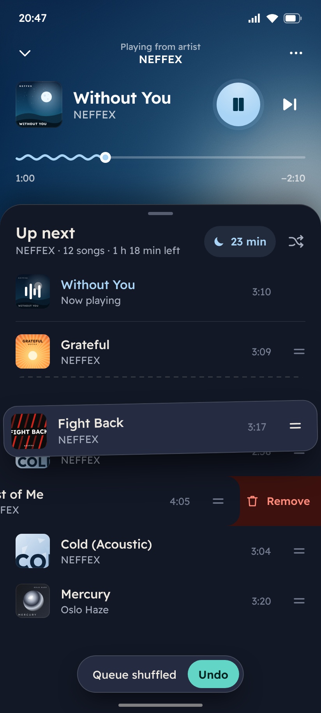 | 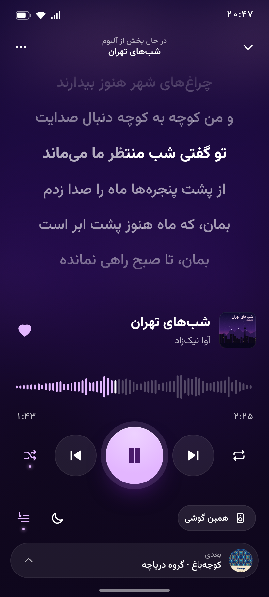 |

## Features

Implemented (code exists and is covered by unit tests where noted):

- **Library** - incremental MediaStore scan into SQLite (also on first run right after the permission is granted); songs, albums, artists, playlists, liked songs, history, play counts. Hub with a blurred liked-songs collage and a 2x2 grid, skeleton loading states.
- **Home feed** (hero carousel, skeleton loading) built from your own library and listening history (quick picks, albums, playlists - ranked by your plays).
- **Search** across songs, albums, artists and playlists with filters.
- **Playback** - Media3 ExoPlayer in a foreground `MediaSessionService`: notification, lock-screen / Bluetooth / headset buttons,
  audio focus, pause on headphones unplug.
- **Add to playlist** - from the track menu and the player menu: pick an existing playlist or create a new one.
- **Queue** - play next, add to queue, drag to reorder, swipe to remove with undo, shuffle with undo, repeat off / all / one,
  queue and position restored after a restart.
- **Sleep timer** - N minutes (with fade-out) or end of track; default configurable.
- **Lyrics** - embedded tags (ID3 / FLAC / MP4), sidecar `.lrc` / `.txt`, then optional online lookup on
  [LRCLIB](https://lrclib.net) (toggle in Settings). Synced lines highlight and tap-to-seek; results (and misses) are cached. When offline, a Retry chip appears.
- **Seek-bar styles** (Settings): *Wavy* (default), *Waveform* and *Bars*; waveform data is the real loudness envelope, extracted
  lazily on-device and cached.
- **Player** - light and dark player with a contrast guard on the cover-derived accent, an output-route chip (This phone / Bluetooth / ...),
  and a cover flight transition between mini-player and full player.
- **Notification permission** is requested on the first play (Android 13+).
- **Themes** - system / light / dark / black, optional colors from the cover art, contrast-guarded accent.
- **Persian & RTL** - full `fa` translation, Vazirmatn font for Persian (chosen per script, so mixed Persian/Latin text uses the right font), mirrored layouts; seek bars and transport buttons stay LTR.
  Language can be switched in Settings.
- **Battery saver** - setting (Auto / On / Off) that disables motion, blur and grain; also honours the system reduce-motion setting.

Not yet (planned, not in v0.1.0): equalizer, home-screen widget, Android Auto, rename / delete / remove-from-playlist UI,
rescan button, music-folder picker (UI row is display-only), tag editor, crossfade, online catalog.

## Install

1. Download `MusicPlayer-v0.1.0.apk` (and optionally the `.sha256`) from the
   [Releases page](https://github.com/mhrsdev/music-player/releases).
2. Verify: `sha256sum -c MusicPlayer-v0.1.0.apk.sha256`.
3. Open the APK on the phone and allow "install unknown apps" for your browser / file manager.

**Signing note.** Unless the maintainer has configured a release keystore, release APKs are signed with the standard Android
**debug** key. They install fine, but (a) they are not store-grade signed and (b) updating from an APK signed with a different key
requires uninstalling the old app first (this loses app data: likes, playlists, history).

## Build from source

Requirements: JDK 17+ (built with 21), Android SDK with `platforms;android-37.0` and `build-tools;35.0.0`.

```bash
export ANDROID_HOME=/opt/android-sdk        # or sdk.dir in local.properties (gitignored)
./gradlew :app:assembleDebug                # app/build/outputs/apk/debug/app-debug.apk
./gradlew :app:assembleRelease              # R8 + resource shrinking, app/build/outputs/apk/release/app-release.apk
adb install -r app/build/outputs/apk/debug/app-debug.apk
```

Version and signing are controlled by Gradle properties / environment variables:

| Name | Meaning | Default |
|---|---|---|
| `-PappVersionName` | `versionName` | `0.1.0` |
| `-PappVersionCode` | `versionCode` | `1` |
| `RELEASE_KEYSTORE_FILE`, `RELEASE_KEYSTORE_PASSWORD`, `RELEASE_KEY_ALIAS`, `RELEASE_KEY_PASSWORD` | release signing (property or env var) | unset: debug keystore |

<details><summary>Installing the Android SDK on a bare Linux box</summary>

```bash
mkdir -p /opt/android-sdk/cmdline-tools && cd /tmp
curl -fLO https://dl.google.com/android/repository/commandlinetools-linux-11076708_latest.zip
unzip -q commandlinetools-linux-11076708_latest.zip
mv cmdline-tools /opt/android-sdk/cmdline-tools/latest
yes | /opt/android-sdk/cmdline-tools/latest/bin/sdkmanager --sdk_root=/opt/android-sdk --licenses
/opt/android-sdk/cmdline-tools/latest/bin/sdkmanager --sdk_root=/opt/android-sdk \
  "platform-tools" "platforms;android-37.0" "build-tools;35.0.0"
```
</details>

| Toolchain | Version |
|---|---|
| Gradle wrapper | **9.0.0** |
| Android Gradle Plugin | **8.13.2** (newest that runs on Gradle 9.0.0; AGP 9.x needs Gradle >= 9.1) |
| compileSdk / targetSdk / minSdk | 37 / 37 / 26 |

AGP 8.13 officially supports up to compileSdk 36, hence `android.suppressUnsupportedCompileSdk=37.0` in `gradle.properties`.
Dependency versions are pinned in `gradle/libs.versions.toml`.

### Releasing
Two ways to make a release, both handled by `.github/workflows/release.yml`:

1. **Push a tag** `vX.Y.Z`.
2. **Run it manually**: GitHub > Actions > *Release* > *Run workflow*, pick the branch (normally `main`) and enter the version
   (e.g. `0.1.0`). GitHub creates the tag `v<version>` itself at the head commit of that branch.

The workflow runs the unit tests and `assembleRelease`, then publishes a GitHub Release with
`MusicPlayer-vX.Y.Z.apk`, its `.sha256` and the matching `CHANGELOG.md` section. Tags that start with `v0.` or contain `-` are
marked pre-release. Optional repository secrets for real signing: `ANDROID_KEYSTORE_BASE64`, `ANDROID_KEYSTORE_PASSWORD`,
`ANDROID_KEY_ALIAS`, `ANDROID_KEY_PASSWORD`.

## Tests

```bash
./gradlew test      # JVM unit tests (JUnit 4 + Robolectric for SQLite/Views): data, lyrics, playback logic, ViewModels, widgets
./gradlew lint
```
CI (`.github/workflows/android.yml`) runs `assembleDebug test lint` on every push. There are no instrumented (on-device) tests yet.

## Architecture

Single `:app` module, package-by-layer. Details and the UI/data contracts: [`docs/ARCHITECTURE.md`](docs/ARCHITECTURE.md).

```
 ui/*  (Activity, Fragments, custom Views)        View       - ViewBinding, no business logic
   |  observes LiveData / calls intents
 ui/*ViewModel                                    ViewModel  - LiveData only, no Context / View refs
   |
 domain/repository (interfaces) + domain/model (records)
   ^                       ^
 data/*                 playback/*
 SQLite, scanner,       Media3 ExoPlayer + MediaSessionService,
 lyrics, waveform,      queue store, sleep timer
 settings
 di/AppContainer  - hand-written DI (no Hilt/Koin), cheap to construct
```

- `ui` never imports `data.*` / `playback.*`; it only sees `domain` interfaces handed out by `di/AppContainer`.
- **Framework SQLite** (`SQLiteOpenHelper`): all SQL lives in `data/db/query/*Queries`, table/column names in `data/db/contract/*Contract`.
- **No Room, no Kotlin, no coroutines/RxJava**: one `ioExecutor` thread (exits after 30 s idle); results arrive as `LiveData`.
- **Media3** `MediaSessionService` owns the single in-process `ExoPlayer`; the UI controls it through `PlayerController`.
- Artwork is loaded by a small own bitmap loader with a capped `LruCache` (no image library).

### Battery and RAM design
- No wake locks of our own; ExoPlayer's local wake mode only while playing. The service stops about 60 s after playback stops.
- Position updates only while playing and the UI is visible; observers are lifecycle-bound; no background polling or sync.
- Animations (wavy, bars, blur, grain) stop when the app or player is not visible and are disabled by battery saver / reduce motion.
- Library scan is incremental; waveform extraction is lazy, samples sparse windows, is cached and skipped in battery saver.
- Network only for LRCLIB, on demand per track, cached (including misses), never in the background.
- Downsampled artwork with a few-MB cache; `ioExecutor` thread exits when idle.

## Permissions

| Permission | Why |
|---|---|
| `READ_MEDIA_AUDIO` (Android 13+) / `READ_EXTERNAL_STORAGE` (<= Android 12L, `maxSdkVersion=32`) | read your music from MediaStore |
| `POST_NOTIFICATIONS` | playback notification (Android 13+) |
| `FOREGROUND_SERVICE`, `FOREGROUND_SERVICE_MEDIA_PLAYBACK` | keep music playing in the background |
| `WAKE_LOCK` | CPU stays awake only while a local file is playing (ExoPlayer) |
| `INTERNET` | **only** for the optional LRCLIB lyrics lookup (can be switched off in Settings) |

## Privacy

No analytics, no ads, no accounts, no crash reporting, no tracking. Your library, likes, playlists and history stay on the device
(`allowBackup` is off). The only network request the app makes is the optional LRCLIB lookup: it sends the track **title, artist,
album and duration** to `lrclib.net` when lyrics are not found locally and "Find lyrics online" is enabled. Turn it off in
Settings > Lyrics to make the app fully offline.

## Project structure

```
app/src/main/java/com/mhrsdev/musicplayer/
  MusicPlayerApp, MainActivity     application + single-activity shell
  di/                              AppContainer and per-layer modules
  domain/{model,repository}/       records + interfaces the UI codes against
  data/{db,scanner,repository,lyrics,waveform,settings}/
  playback/                        ExoPlayerController, PlaybackService, queue store, sleep timer
  ui/{theme,widget,nav,home,search,library,player,queue,settings}/
  fake/                            in-memory implementations used by tests and render previews
app/src/main/res/                  layouts, drawables, fonts, values (en) + values-fa
app/src/test/                      JVM unit tests
docs/                              ARCHITECTURE, DESIGN, STATUS, screenshots, design mockups
.github/workflows/                 android.yml (CI), release.yml (tag -> GitHub Release)
```

## Contributing / project rules

Java only (`git ls-files | grep -E '\.kts?$'` must print nothing; Gradle files are Groovy), MVVM, no Room (framework SQLite, SQL only
in query classes), clean packages, Gradle 9.0.0. Battery and RAM use are hard requirements. Read `CLAUDE.md`, `docs/STATUS.md` and
`docs/ARCHITECTURE.md` first. Work on a branch; `main` is the delivered state.

## Known limitations

- **Not verified on a real device**: MediaStore scan on real libraries, notification / lock screen / Bluetooth, foreground-service
  start on Android 14+, MediaCodec waveform extraction, battery drain. Visuals are verified only through Robolectric renders.
- The release APK is debug-signed (see Install); no automatic updates.
- Persian copy has not been reviewed by a native speaker.
- LRCLIB availability is outside our control (it returned occasional 503s during development).
- Playlist rename / delete / remove-track UI, a rescan button and the folder picker do not exist yet (the folder row in Settings is display-only).
- No online catalog or streaming: the app plays files on the device only.

## Roadmap

Planned, not implemented: equalizer, home-screen widget, Android Auto, playlist editing in the UI (rename / delete / remove), rescan button, music-folder
picker, tablet / landscape layouts, crossfade, tag editing, signed releases with a real keystore, on-device test suite, battery audit.

## License

Released under the [MIT License](LICENSE) - Copyright (c) 2026 mhrsdev.

The bundled fonts (Google Sans Flex, Vazirmatn) are under the SIL Open Font License 1.1; see
[`app/src/main/assets/licenses/FONTS-NOTICE.txt`](app/src/main/assets/licenses/FONTS-NOTICE.txt).
